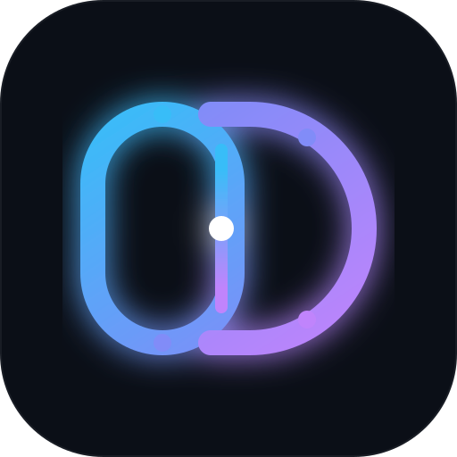

# OmniDesk (OmniHarness)

> **Personal AI Operating Environment · 个人专属 AI 工作操作系统**  
> 基于 DeepSeek Harness (DSH) 核心底座构建，面向个人知识沉淀、长期记忆保持、项目敏捷协作与内容自动化生产。

---

## 视觉形象与品牌标识 (Monogram O-D)

<div align="center">
  
  <p><strong>OmniDesk — The Sovereign AI Workbench</strong></p>
</div>

- **左环 [ O · Omni ]**：连续运行的 Agent Loop 状态机闭环，象征稳固的 DSH 运行时底层。
- **右弧 [ D · Desk ]**：开放延展的工作台操作面，承载五大专业特种 Agent。
- **中轴 [ Neural Seam ]**：白色神经分发中枢，打通记忆、知识与工程项目的无缝互联。
- **设计原型与规范**：详见 [docs/brand-and-ui/preview.html](docs/brand-and-ui/preview.html)。

---

## 系统五层分层架构

OmniDesk 采用单向解耦依赖模型，详细架构定义请参阅 [docs/ARCHITECTURE.md](docs/ARCHITECTURE.md)：

```text
┌────────────────────────────────────────────────────────┐
│                      UI Layer                          │
│        (Desktop App Shell / Web Browser / CLI)         │
└───────────────────────────┬────────────────────────────┘
                            │
┌───────────────────────────▼────────────────────────────┐
│                External Data Layer                     │
│    (~/YvanAI: knowledge, memory, projects, backups)    │
└───────────────────────────▲────────────────────────────┘
                            │ (读写通用 Markdown/JSON 资产)
┌───────────────────────────┴────────────────────────────┐
│                    Skills Layer                        │
│    (memory, knowledge, project, writing, coding)       │
└───────────────────────────┬────────────────────────────┘
                            │ (声明式注册 / ctx.skills)
┌───────────────────────────▼────────────────────────────┐
│                   Profile Layer                        │
│  (cordis.patch.yml: 模型路由, UI偏好, 工具裁剪, 插件管理) │
└───────────────────────────┬────────────────────────────┘
                            │ (Cordis 插件树装配)
┌───────────────────────────▼────────────────────────────┐
│                    DSH Runtime                         │
│  (runtime/deepseek-harness: AgentLoop, Seams, Session) │
└────────────────────────────────────────────────────────┘
```

---

## 架构三大红线（不可破坏的边界）

1. **绝对禁止修改 DSH Runtime 核心**：`runtime/deepseek-harness` 作为官方纯净底座隔离维护，所有功能扩展必须通过 Profile 配置补丁、外部 Skill 或标准 MCP 协议实现，保障 DSH 升级无痛。
2. **绝对禁止将个人知识库放入 DSH 内部**：个人资产固定存储于 `~/YvanAI/`（通用 Markdown/JSON），与 Obsidian/Hugo 静态站打通，避免与任何特定软件私有格式绑定。
3. **绝对禁止将用户个人数据放入 Git 项目代码库**：代码库仅管理框架、配置模板、Agent 技能与自动化脚本，严防会话私有数据和敏感凭证入库。

---

## 项目代码库目录规划

```text
omniharness/
├── runtime/              # 底层运行环境底座 (DSH 官方只读源码 + Linux 打包补丁)
├── profiles/             # Cordis / DSH Profile 定制配置 (模型路由、UI 裁剪)
├── skills/               # 专属 Agent 技能层 (基于纯 Markdown 提示词契约)
│   ├── memory-agent/     # 长期记忆与关键决策记录
│   ├── knowledge-agent/  # 知识检索与跨库整合
│   ├── project-agent/    # 工程巡检与进度追踪
│   ├── writing-agent/    # 自动化材料产出
│   └── coding-agent/     # 代码辅助与架构分析
├── scripts/              # 自动化运维工具 (初始化资产骨架、会话备份、Skill 同步)
├── data-template/        # ~/YvanAI/ 外部资产目录的基础规范与模板
└── docs/                 # 系统架构规范、分析报告与品牌设计体系
```

---

## 快速运维指令

- **初始化本地外部数据中心**：
  ```bash
  ./scripts/init-yvan-data.sh
  ```
- **备份 DSH 会话与工作区索引**：
  ```bash
  ./scripts/backup-sessions.sh
  ```
- **将自定义 Skills 装载至当前 DSH**：
  ```bash
  ./scripts/sync-skills.sh
  ```


---

## 当前落地产品：OmniDesk Discipline v0.1

面向纪检监察综合履职场景的专业 AI 工作站：
- **设计原则与系统宪法**：详见 [docs/OmniDesk-Design-Principles-v0.3.md](docs/OmniDesk-Design-Principles-v0.3.md)
- **阶段执行计划与验收标准**：详见 [docs/OmniDesk-Discipline-MVP-Plan-v0.1.md](docs/OmniDesk-Discipline-MVP-Plan-v0.1.md)
- **工作站工作目录**：[workstations/discipline/](workstations/discipline/)
- **材料模板库**：[templates/discipline/](templates/discipline/)
- **黄金任务基准集 (20 Case)**：[tests/golden_tasks/](tests/golden_tasks/)
- **真实场景验证报告**：[tests/reports/v0.1-validation-report.md](tests/reports/v0.1-validation-report.md)

