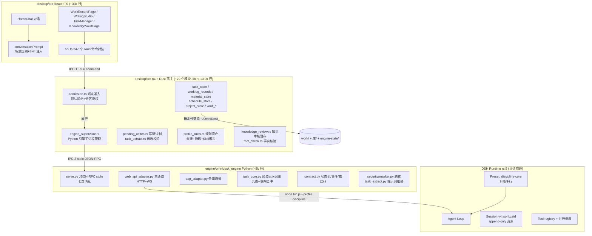

# OmniDesk 现有架构审计（Harness Engineering + Multi-Agent Graph 专项审计 · 第一部分）

> 状态：OD-ARCH-150 审计成果（文档，未实施任何代码改动）。基线：main @ ec519c618d，DSH 锁定 rc.5（runtime/RUNTIME.lock），引擎 Profile discipline（discipline-core preset）。
> 证据等级约定沿用项目惯例：static（文件/源码事实）· script（实跑）· model（真实模型输出）· unverified（未验证）。本文所有结论均标注等级。
> 关联文档：[存储审计](OMNIDESK_STORAGE_ARCHITECTURE_AUDIT.md) · [Harness 设计](OMNIDESK_HARNESS_ARCHITECTURE.md) · [Graph 设计](OMNIDESK_MULTI_AGENT_GRAPH_DESIGN.md) · [试点设计](WORK_REVIEW_AGENT_DESIGN.md) · [路线图](OMNIDESK_HARNESS_ROADMAP.md)

## 一、总体判定（先回答四个根本问题）

1. **OmniDesk 当前是不是一个真正的 Agent 系统？** 是「宿主编排 + 单一执行 Agent」系统。Agent 循环、工具执行、会话持久化全部在 DSH Runtime（runtime/dsh-runtime/node_modules/@deepseek-ai/dsh，rc.5）内；OmniDesk 宿主（Rust）负责准入、任务台账、写确认、落盘，前端负责提示词组装与场景 Skill 注入（static：desktop/src/conversationPrompt.ts、engine/omnidesk_engine/web_api_adapter.py）。**没有**多个可独立编址的 Agent Profile；「agent」一词目前只出现在 Skill 文件名与 DSH 内部机制里。
2. **DSH Runtime 是否适合承载四个逻辑 Agent？** 适合（static + script 证据）。DSH 的 Profile/Preset 是声明式分层（runtime/dsh-home/profiles/discipline/cordis.patch.yml 定义 discipline-core preset，9 个插件行），Agent Loop 是「一个 preset 配置驱动的一个循环」，同一 DSH 进程按会话组合配置。四个逻辑 Agent = 四套「场景 → Skill 绑定 → 工具面 → 验收器」配置，由同一个 Runtime 承载，不需要四个进程或四个 DSH 实例。已有先例：omnidesk-base 与 discipline 两态 Profile 共存于同一 dsh-home，切换只改组合（script：OD-ARCH-082 --dump-config 对比证据，tests/verification/desktop/evidence/od-arch-082/）。
3. **是否需要替换或扩展 Runtime？** 不需要替换（static）。DSH 的事件日志是 append-only 真源、投影折叠生成请求（docs/research/dsh-runtime-audit/08-dsh-core-architecture-map.md，S 证据）；OmniDesk 所有定制已通过 Profile patch、Skill、宿主命令实现，runtime/ 零差异。需要的「扩展」全部位于 OmniDesk 层：Agent Profile 声明文件、统一事件表、验收器注册，均是新文档规划的 OmniDesk 侧模块。
4. **Skills 体系是否适合多 Agent 复用？** 基本适合（static）。Skill 是纯 Markdown 提示词契约（skills/*/SKILL.md，10 个），绑定由 Profile 规则资产 skill_bindings 表达（samples/profiles/discipline.rules.json；desktop/src-tauri/src/profile_rules.rs 校验），注入按场景/流程取用（desktop/src/conversationPrompt.ts presetSkillsFor）。复用缺口：Skill 无 per-Agent 权限声明、无跨 Agent 输入输出 Schema、无「哪个 Agent 可用哪个 Skill」的机器可读归属（当前归属只按场景键）。

## 二、真实代码架构（static，源码实读）

### 2.1 各层职责与调用方式（static）

| 层 | 位置 | 职责 | 模型/工具调用方式 |
| --- | --- | --- | --- |
| UI | desktop/src | 对话、场景页、素材/任务/知识界面 | 只走 Tauri command（api.ts）；不解析协议 |
| 宿主 | desktop/src-tauri | 准入、IPC、写确认、业务落盘、候选校验、规则资产 | spawn python -m omnidesk_engine（engine_supervisor.rs） |
| 引擎适配 | engine/omnidesk_engine | 归一化任务/事件/状态；脱敏；提示词组装 | web_api_adapter 起 node bin.js --profile discipline --port 0（主），ACP 备用 |
| DSH Runtime | runtime/（不改） | Agent 循环、工具执行、会话日志、preset 组合 | 内部机制，OmniDesk 只见归一化事件 |

### 2.2 Agent 实现现状（对照审计要求逐项，static）

| 检查项 | 现状 | 证据 |
| --- | --- | --- |
| Agent 定义方式 | 无独立 Agent 实体。等价物 = 场景 preset（工作记录/文案写作/项目跟踪，desktop/src/scenes.ts）+ skill_bindings（rules.json）+ discipline-core 工具面 | scenes.ts、profile_rules.rs、cordis.patch.yml |
| 独立配置 | Profile 级有（rules.json 每场景 rules/sections/thinking）；Agent 级无 | samples/profiles/discipline.rules.json |
| 系统指令加载 | 两处：DSH persona/agent-instructions（patch 静态）+ 宿主按场景拼提示词（动态） | cordis.patch.yml、conversationPrompt.ts |
| Skill 选择 | 按 skill_bindings 场景键，max_injected 限 1；按需 Skill（anysearch 等）模型自行读 | profile_rules.rs:164、SKILL.md「按需加载」节 |
| 工具调用 | DSH tool registry（discipline-core 9 插件行：persona/agent-instructions/time-context/tool-fs/skill-filesystem/tool-skill/compaction/tool-ask-user/tool-web + bash/pwsh/fs-search per D-092a） | D-092/D-092a 决策记录 |
| 上下文维护 | DSH 会话投影 + compaction（runtime 内）；UI 端新会话重放上文（CONTEXT_MAX_CHARS 2500） | conversationPrompt.ts:100 |
| 独立记忆 | 无 Agent 级记忆。共享数据 = work/ 库/ 文件；会话 = DSH session.v4.jsonl.zstd + app/threads/*.json | §三 存储审计 |
| 失败处理 | 引擎事件 task_failed + 错误码 13 类（contract.py EngineErrorCode）；宿主校验失败置 ai_analysis_status=failed | contract.py、task_extract.rs |
| 结果交付 | 结果持久化 engine-state/results/ + 结果文本返回；写操作全部走 pending_writes 确认 | pending_writes.rs |
| 子 Agent / Agent 间调用 | 不存在。D-092 明确移除 delegation 组（subagent/workflow）；用户指令「不派子代理」 | decisions.md D-092 |
| 任务状态与恢复 | 九态状态机（contract.py TaskState）+ 合法转换表 + 台账恢复 + 会话 resume/fork（serve.py m_recover_session/m_fork_session） | contract.py、task_core.py |

## 三、业务能力真实清单（对照第四部分要求）

### 3.1 已实现且已有验收证据（script 证据在 tests/verification/）

| 能力 | 实现 | 验收证据 |
| --- | --- | --- |
| WorkRecord 工作记录 | worklog_records.rs 完整 CRUD + 修订 revisions.jsonl + raw_input 原始素材分离 | od-wr-501/502 证据目录；OD-WR-500 审计报告 |
| 随手记语义判定 | memory-agent Skill 判定块 + 宿主逐字校验落盘（模型无写权限） | verify_worklog_103/132.py、evidence/od-arch-108 flow-injection.json |
| TaskCandidate 任务提取 | task_extract.rs/py：红线→掩码→提示词→模型→宿主校验→.candidates 暂存→用户确认落任务 | 真实数据 ~/OmniDesk/work/.candidates/已处理/tc-*.json（已确认 2 条）；od-wr-504 |
| Task 任务实体 + 四象限 | task_store.rs 状态机/依赖/父任务/象限 override + priority_rules.rs | od-wr-507、QS-4xx 竣工（PLANS.md） |
| ScheduleEntry 排期 | scheduling.rs 纯函数排期引擎 + schedule_store.rs 锁定/确认/调整 | OD-QS-408 模块测试 |
| Knowledge Hub 四层 | 库/raw+inbox+知识库+governance；vault_read/write/search/index/link/graph | OD-KB-001 P1-P4 复核记录（REVIEW.md） |
| 知识整理审核 | knowledge_review.rs 暂存→裁决→apply；真实数据 5 条审核（4 approved 1 rejected） | knowledge-reviews/*.json |
| 双链和知识图谱 | vault_link.rs 解析 + vault_index.rs 关系 + KnowledgeGraphView 现算 | vault_index/tests.rs；knowledgeGraph.test.mjs |
| 写作素材篮 | material_store.rs 五态审核+指纹去重+来源定位；素材候选与任务候选同车返回 | od-wr-504（素材候选）、od-wt-605 |
| material-writing 写作 | 八层工作流：604 解析→605 收集→606 大纲→607 分章→608 审阅→609 事实核验→610 工作台→版本快照 | od-wt-602..615 证据目录 14 个 |
| 事实核验 | fact_check.rs 八类结论确定性引擎（直接/间接来源、冲突、过期、无来源、分析、计划、概括） | od-wt-609 |
| knowledge-search | 两跳检索（索引→卡）+ 词法检索 vault_search（32MiB 预算） | retrieval 证据、REVIEW P2 复核 |
| Golden Tasks | tests/golden_tasks 40 个基准任务（GT-01~40） | tasks.json |
| 备份 | backup-workspace.sh 全量镜像（~/.dsh 会话 + OmniDesk 根）；应用内 Profile 资产 .bak | 脚本本体 |
| 模板库 | templates/discipline 三模板 + writing-templates.v1.json（仓库外可编辑） | writing_outline.rs |
| 文档审阅 | document-review Skill 四维审查 + writing_review.rs 十维检查单 | od-wt-608 |

### 3.2 已实现但缺乏独立验收证据

| 能力 | 现状 | 缺口 |
| --- | --- | --- |
| usage.jsonl 使用记录 | 机制完整（task_usage_record/view/delete），正式根当前 0 条 | 无真实使用数据，价值指标未测 |
| token 消耗上报 | 引擎透传 usage 块为 PROGRESS 事件（web_api_adapter.py:1803）；GOALS.md 明确「引擎未上报 usage 时显示 —」 | 无任务级 token 落盘台账（unknown：DSH usage 块实际字段未验证） |
| 排期生成全流程 | 引擎纯函数已测；与真实数据的端到端验收未见专门证据目录 | 依赖真实使用 |
| work/素材篮、work/知识关联 | 代码与 UI 完整；正式数据根两目录尚不存在（用户未用过该链路） | 无真实使用证据（不算缺陷，标注事实） |

### 3.3 仅设计文档 / 尚未实现

| 项 | 状态 |
 | --- | --- |
| 多 Agent 协作 / Agent 间交接 | 仅本次规划文档，未实现 |
| 统一业务事件表 | 无任何 events 持久化（~/OmniDesk 全域检索 *event* 零命中，static）；只有引擎事件流（内存/台账内） |
| Agent 专属记忆视图 | 无 |
| 独立 Agent Profile Registry | Profile index.v1.json 存在（profile_lifecycle.rs）但按 Profile 不按 Agent 角色组织 |
| 周文件存档→复盘→任务的全自动闭环 | period-review 已做（草稿→确认），复盘建议转任务仍需用户手动（符合确认制，非缺口） |

## 四、重复职责 / 循环依赖 / 隐式耦合 / 单点故障（static）

| 类型 | 事实 | 影响 |
| --- | --- | --- |
| 重复职责 | 「工作记录分析」有两个入口：worklog_record_analyze（记录库内逐条）与 material_extract_from_record（写作场景），后者直接转调前者（lib.rs:3457-3467）。同一模型调用返回任务候选+素材候选 | 低。已收敛为单实现；入口命名差异是场景语义，不是重复实现 |
| 隐式耦合 | 场景 Skill 注入依赖 TS conversationPrompt 与 Rust profile_rules 两端对 skill_bindings 键的一致理解（weekly-note 等 7 键无编译期契约） | 中。键拼错静默失效；建议 Phase B 用 schema 校验收敛 |
| 隐式耦合 | lib.rs 13,980 行承载 247 命令注册 + 大量 *_impl；模块边界靠命名约定 | 中。可维护性风险，非功能缺陷 |
| 循环依赖 | 未发现（static：engine 不依赖 desktop；desktop TS 不依赖 Rust 内部；DSH 不依赖任何上层） | — |
| 单点故障 | lib.rs 巨文件；DSH 单进程（会话串行依赖 runtime 稳定性）；owner.json 是进程所有权唯一事实源（设计使然） | 已知并有恢复设计（OD-ARCH-074 回收 + 互斥） |
| 上下文污染风险 | 全局 AGENTS.md/工程规范未注入产品 Agent 提示词；产品系统提示词仅 persona 检索/批处理规则 + 场景规则 + 单 Skill（≤2500 字符） | 现状健康；多 Agent 后 Guides 分层见 Harness 文档 |

## 五、与 Harness² 思想的对照结论（研究性，不引入）

| Harness² 理念 | OmniDesk 现状对应 | 判定 |
| --- | --- | --- |
| Harness 组件化（Guides/Sensors/Memory/Permissions/Loop/Observability 分层） | 分散实现：Guides=SKILL.md+rules.json，Sensors=宿主校验函数（未成体系），Permissions=admission+pending_writes，Loop=DSH+九态，Observability=usage.jsonl+台账+会话日志 | 概念已分散存在，缺统一登记与「Agent 级组装」 |
| Propose–Probe–Compose | 已有同构物：AI 候选（propose）→ 宿主/模型探针校验（probe）→ 用户确认落盘（compose），pending_writes + .candidates + knowledge-reviews 三处先例 | 机制存在，未抽象成统一「候选生命周期」 |
| 任务级改进（跨任务经验沉淀） | decisions.md 记录架构级经验；无任务级失败→规则自动改进通道（人工改 rules.json） | 差距，Phase E 评估 |
| 基于执行证据的 Harness 优化 | STATUS/REVIEW 记录实测证据并驱动规则修订（如 OD-PROFILE-092b 按调用统计加预算规则） | 已有雏形（人工驱动），未自动化 |

**判定：** Harness² 的组件化与「候选→验证→合成」生命周期思想与 OmniDesk 现有确认制高度同构；引入价值在于**统一登记与 Agent 级组装**，而非任何新运行时。具体设计见 OMNIDESK_HARNESS_ARCHITECTURE.md。
