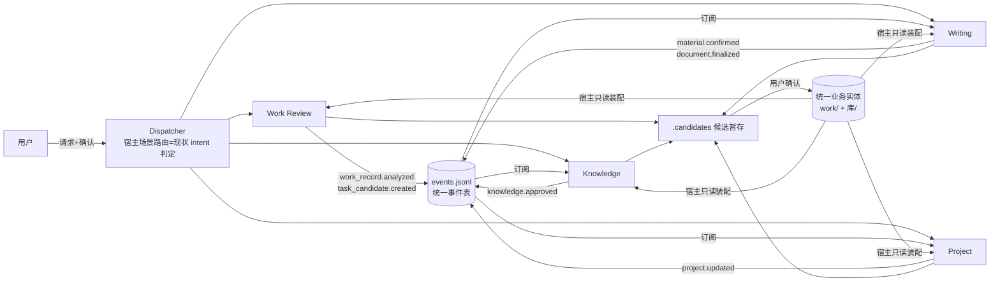

# OmniDesk Multi-Agent Graph 协作架构设计

> 状态：OD-ARCH-150 规划成果（设计文档，未实施；候选方案不写成已决定）。
> 关联：[现状审计](OMNIDESK_CURRENT_ARCHITECTURE_AUDIT.md) · [Harness 设计](OMNIDESK_HARNESS_ARCHITECTURE.md) · [试点设计](WORK_REVIEW_AGENT_DESIGN.md) · [路线图](OMNIDESK_HARNESS_ROADMAP.md)

## 一、四 Agent 职责边界（与用户需求对齐）

| Agent | 职责（输入→输出） | 不做 | 现有实现基础 |
| --- | --- | --- | --- |
| Work Review | 工作记录→事实/进展/完成与待办/任务候选/素材候选/复盘草稿 | 改原始记录；直接建正式任务；改任务状态/排期；改已审知识 | memory-agent/daily-summary/period-review Skill + task_extract 链路（大部分已实现） |
| Knowledge | 资料/记录→知识卡候选；检索；关联推荐；治理 | 直接写知识库；跨级处理敏感材料 | knowledge-agent/knowledge-search Skill + knowledge_ingest/review/link 链路（已实现） |
| Writing | 写作需求→大纲/章节稿/事实核验/修订 | 未经确认落稿；绕过核验出结论 | material-writing Skill + writing 604-615 链路（已实现） |
| Project | 任务/排期/项目状态→简报/风险/依赖检查/任务建议 | 直接改任务状态与排期 | project-agent Skill + project/schedule 链路（已实现） |

**关键事实：四个 Agent 的「单人职责」能力已基本存在**（作为场景 Skill），缺的是把它们组装成可编址的 Agent Profile 与协作机制。这大幅降低改造规模。

## 二、协作模型（候选设计）



协作七原则（用户要求逐条落实）：

1. **结构化交接不靠聊天记录**：交接物 = 候选 JSON（schema 已有 v1）+ 事件行；不传会话正文。
2. **统一事件或任务接口**：轻量本地事件表（见 §四），不做消息中间件。
3. **输入输出 Schema**：复用现有 EXTRACT_SCHEMA（omnidesk.task-candidates.v1）、material-candidates.v1、knowledge-review.v1、writing-requirement.v1；新增 verdict.v1（Harness 文档 §三）。
4. **独立权限**：Harness 文档 §六 的 Agent 级工具面/目录 ACL。
5. **交接可追溯**：候选带 source_id/source_quote/record_id；事件带 entity_id+时间+类型+状态；执行带 omni_task_id。
6. **失败定位**：台账 error_code（13 类）+ 事件 status + 验收 verdict.checks 定位到具体环节。
7. **人工审核反馈成事件**：candidate.confirmed/rejected 事件 + decision_note（Observability 候选补齐 3）。
8. **经验进 Guides/Sensors 须验证**：只有 Golden Task 回归通过或用户明确采纳的规则修订才写 rules.json（人工操作，AI 只建议）。

## 三、十个机制点的设计口径

| 机制 | 设计（复用优先） |
| --- | --- |
| Agent Dispatcher | **不新建**。现状 intent 判定（workIntent.ts 保守判定）+ 场景路由（scenes.ts）已是分发器；扩展点=把 intent 结果映射到 Agent 键而非直接到 Skill 集 |
| Agent Profile Registry | **不新建注册中心**。扩展 Profile 规则资产：rules.json 增 agents 段（每 Agent：绑定场景、Skills、权限变体引用、验收器集）；profile_rules.rs deny_unknown_fields 校验。物理登记沿用 profiles/index.v1.json 模式（如需要） |
| Event Contract | 见 §四 |
| Task Handoff | 结构化候选+事件；无 Agent 间直接调用；不需要 handoff 协议栈 |
| Shared Memory | 统一实体文件（存储审计 §六）；无共享向量库 |
| Agent-specific Memory | 各自候选暂存目录 + 会话（Harness 文档 §五） |
| Workflow Orchestration | **不建工作流引擎**。编排=事件订阅+宿主确定性动作；跨 Agent 链路（记录→候选→任务→素材→文稿）由用户在 UI 逐环确认驱动（现状即此） |
| Failure Recovery | 台账+会话恢复+候选 TTL（Harness 文档 §四） |
| Human Approval | pending/verdict/candidate 三层已有先例；统一 verdict 展示 |
| Observability | Harness 文档 §七 |

## 四、Event Contract（轻量事件表，候选设计）

```json
{"seq": 12, "ts": "2026-11-13T10:00:00Z", "type": "task_candidate.confirmed",
 "actor": "user", "entity": {"kind": "task_candidate", "id": "tc-..."},
 "ref": {"record_id": "wr-...", "task_id": "t-..."}, "status": "processed"}
```

- 落点（已实施，D-094）：work/events.jsonl 追加式单文件；所有业务写入入口都持有该根，避免改动函数签名。
- 事件类型首批（全部由宿主在现有动作点追加，不引新总线）：work_record.created/updated、task_candidate.created/confirmed/rejected、task.confirmed/progress.updated/completed、knowledge.link.suggested/approved、material.extracted/confirmed、document.finalized、project.updated、review.* （Agent 生命周期）。
- 消费者：Agent 启动时读最近事件装配上下文（替代轮询）；UI 时间线复用。
- **不引入**：分布式消息、事件溯源重建、跨进程广播。单文件追加即可满足单用户场景。

## 五、三方案对比与推荐（必须决策项）

| 维度 | A. 单 Agent+Skills（现状） | **B. 四逻辑 Agent+共享 Runtime（推荐）** | C. 四独立 Runtime |
| --- | --- | --- | --- |
| 开发复杂度 | 最低（已存在） | 低：Agent 声明段+事件表+verdict+权限变体；无新进程/协议 | 高：四份数据根/端口/生命周期管理（OD-ARCH-074 的互斥设计明确反对同根多实例） |
| Token 消耗 | 低（单循环） | 低-中：每 Agent 精简工具面（比单全能 Agent schema 更小）；事件订阅免轮询 | 高×4（四份 preset/schema 常驻） |
| 上下文隔离 | 无隔离（全场景规则混在一个循环可及范围） | **好**：每 Agent 只注入自己的 Skill 集+材料；会话按场景分线程（现状已分） | 最好但成本不值 |
| 数据一致性 | 天然一致 | **好**：共享实体+唯一写口不变；候选制防副本 | 差：四 Runtime 各自缓存/会话需同步，违反唯一事实源 |
| 运行稳定性 | 好 | 好：仍单 DSH 进程；Agent 是配置非进程 | 差：进程管理复杂度×4（孤儿/互斥/回收问题放大） |
| 维护成本 | 最低 | 中低：复用 profile/preset/skill 三层维护模式 | 高 |
| 与既有原则契合 | 契合（但无法满足「角色独立」需求） | **契合**：不建通用平台、不增协议、runtime/ 不动 | 违反「不默认四进程」边界 |

**推荐：方案 B。** 理由：四个 Agent 的职责能力已存在为场景 Skill；B 只增加「配置层组装」（Agent 声明+权限变体）与「协作层」（事件表+verdict），全部在 OmniDesk 层；C 的全部额外成本（进程、数据根、同步）换不来单用户场景需要的任何收益；A 无法满足角色独立与专业验收要求。B 保留向 A 收敛的退路（Agent 声明只是规则资产，删掉即回到现状）。

## 六、失败经验不污染机制（用户问题 13）

1. 经验写入 Guides 的唯一通道是人工修订 rules.json/SKILL.md（AI 只建议）；
2. 规则修订必须过 Golden Task 回归（tests/golden_tasks + verify 脚本）后才生效——把「验证经验」做成规则修订的验收标准（写进路线图 Phase E）；
3. 候选失败的教训留在候选 JSON（decision_note）与事件表，不自动改任何规则；
4. Sensors 是独立确定性代码，不接受 Agent 自评——模型无写验收器权限。
