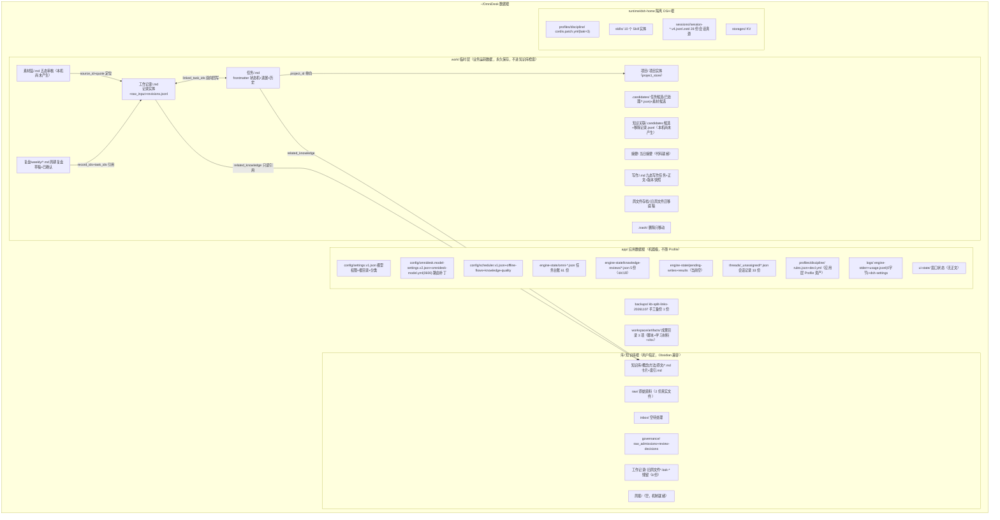

# OmniDesk 数据存储体系审计（专项审计 · 第三部分重点）

> 状态：OD-ARCH-150 审计成果（文档，未实施改动）。数据事实采集自本机正式数据根 ~/OmniDesk（只读，未读任何正文正文之外的敏感内容；文件结构属元数据）。
> 关联：[现状审计](OMNIDESK_CURRENT_ARCHITECTURE_AUDIT.md) · [Harness 设计](OMNIDESK_HARNESS_ARCHITECTURE.md) · [路线图](OMNIDESK_HARNESS_ROADMAP.md)

## 一、实际存储结构图（static + 本机 script 核实）

## 二、逐实体登记表（读写入口均为 Rust 宿主模块，static）

| 实体 | 位置 | 格式 | 读写入口 | 生命周期 | 备份 | 可重建 |
| --- | --- | --- | --- | --- | --- | --- |
| WorkRecord | work/工作记录/<id>.md | MD+frontmatter omnidesk.worklog-record.v1 | worklog_records.rs（宿主唯一写口，原子写+修订 jsonl） | 永久（临时层语义，不进知识库检索） | backup-workspace.sh 镜像 | 否（事实源） |
| TaskCandidate | work/.candidates/*.json | omnidesk.task-candidate.v1 | task_extract.rs 暂存→task_candidate_confirm 转任务 | 决定后归档 已处理/ | 同上 | 可删（已确认的已落任务） |
| Task | work/任务/<id>.md | omnidesk.task.v1 | task_store.rs 状态机 | 永久 | 同上 | 否 |
| ScheduleEntry | work/排期/（schedule_dir） | omnidesk.schedule.v1 | schedule_store.rs | 永久+过期清理 | 同上 | 否（建议可重算） |
| Project | work/项目/ | omnidesk.project.v1 | project_store.rs | 永久 | 同上 | 否 |
| Knowledge 卡片 | 库/知识库/概念|方法/*.md | MD+frontmatter(tags/sources/date)+索引.md | vault_write.rs（唯一写口）+knowledge_ingest.apply | 永久 | backups/ 手工 | 否 |
| WritingMaterial | work/素材篮/<id>.md | omnidesk.material.v1 | material_store.rs | 永久 | 同上 | 否 |
| Document（写作稿） | work/写作/<wid>.md+versions/ | omnidesk.writing.v1 | document_store.rs 快照唯一写口 | 永久 | 同上 | 否 |
| AgentExecution（任务台账） | app/engine-state/omni-*.json | omni 台账 JSON（state/seq/ttfb/error） | task_core.py+lib.rs | 终态保留 | 随 app/ | 否（审计线索） |
| AgentMemory | 无独立存储 | — | — | — | — | — |
| Event | 无持久事件表 | 引擎事件在台账 seq+会话日志 | — | — | — | — |
| Decision | docs/decisions.md（架构）+复盘/治理文件（业务） | MD | 人工+宿主 | 永久 | Git+镜像 | 否 |
| ReviewHistory | 治理 review-decisions.v1.md + knowledge-reviews/*.json + 写作审核记录段 | MD+JSON | knowledge_governance.rs 等 | 永久只追加 | 同上 | 否 |
| DSH 会话 | runtime/dsh-home/sessions/session-*.v4.jsonl.zstd | zstd JSONL append-only | DSH 内部 | 永久（5.0MB/28 份） | backup-workspace.sh | 否（对话真源） |
| 线程记录 | app/threads/<分类>/<tid>.json | v1 JSON | thread_store.rs | 永久 | 随 app/ | 否（localStorage 已降级缓存） |

## 三、十问十答（全部结论基于上文证据）

1. **业务数据是否有唯一可信来源？** 是。每类实体一个目录一个写口：记录=work/工作记录、任务=work/任务、素材=work/素材篮、知识=库/知识库、写作=work/写作。模型没有写权限（「你判语义，工作台落盘」，skills/memory-agent/SKILL.md）。例外：旧周文件在 库/工作记录/ 留有 8 份 .bak 迁移残留（已迁移至 work/，属清理问题非双源）。
2. **是否存在 Agent 间数据副本？** 无 Agent 副本（无多 Agent）。实体间仅存 id 引用（linked_task_ids、related_knowledge、source_id），不复制正文。发现的重复：知识卡 frontmatter sources 引用 raw 文件（引用非副本，合规）；索引.md 复述卡片标题摘要（索引可重建，属派生缓存语义）。
3. **工作记录与任务能否稳定关联？** 能（已验证）。candidate.source_record_id→task 落盘，任务 linked_record_ids 双向回写（task_store.rs「OD-WR-307 双向回写」）；真实数据实例：t-1794136957↔wr-1794130801-92384-1。
4. **工作记录与知识库能否稳定关联？** 能（代码已实现，本机无实例）。related_knowledge 字段（记录与任务都有）+ 知识关联候选流程（knowledge_link_store.rs，work/知识关联/.candidates）；本机用户尚未走过该链路（目录不存在，标注事实）。
5. **知识与素材能否追溯来源？** 能（代码已实现）。素材必填 source_type+source_id+source_quote+source_location+指纹去重（material_store.rs）；知识卡必填 sources[]（卡片 frontmatter）；反查 worklog_record_backlinks 命令已注册。
6. **项目能否组织任务、记录、知识与成果？** 部分（static）。任务有 project_id 单向挂接；素材有 related_project_id；project_overview 反向派生聚合任务/素材/记录（project_store.rs push_ref_kind）；**知识卡无 project 关联字段**（知识库只读设计使然），成果按场景 scenario 归档不挂项目。差距：项目对知识与成果的组织需要靠记录/任务间接达成。
7. **Agent 能否通过 ID 读取统一数据？** 能（static）。全部实体 id 形状稳定（wr-/t-/tc-/m-/p-/kr-）；Skill 通过宿主注入的材料拿 id；模型按需用 tool-fs 读文件（knowledge-search Skill 两跳检索读索引→卡）。
8. **数据更新是否有审计历史？** 大部分有。记录 revisions.jsonl 逐字段留痕；任务 状态历史+进展+调整 三段只追加；素材 审核记录段；知识 治理文件+审核 JSON；写作 版本快照。**无审计的**：settings 修改、profile_rules 编辑（有 .bak 单份）、engine-state 台账本身（台账即审计线索，但无独立审计日志）。
9. **索引重建是否影响业务数据？** 否（设计保证）。vault_index 是纯派生（P3 快照不落盘，前端现算）；knowledge_vault.rs 只读扫描「不建立持久索引，不写任何文件」；work Cleanup 排除清单保护素材篮/写作（work_cleanup.rs EXCLUDED）。索引.md 是唯一落盘索引，重建由 knowledge_ingest.apply 流程重写，卡片原文不动。
10. **备份恢复能否保证业务关系完整？** 文件级能（backup-workspace.sh 全量镜像），但存在三个问题：① backup-sessions.sh 仍指向 ~/.dsh/sessions 与 ~/YvanAI（scripts/backup-sessions.sh 第 7-9 行），对当前隔离数据根 ~/OmniDesk/runtime/dsh-home 无效，属过时脚本；② 无自动定时备份（仅手工镜像+应用内 .bak）；③ 恢复演练无验收记录（unknown：从未实测恢复）。

## 四、数据分类（正式业务 / AI 记忆 / 可重建缓存 / 原始文件 / 执行状态）

| 类别 | 内容 | 版本控制 | 可删除重建 |
| --- | --- | --- | --- |
| 正式业务数据 | work/工作记录、任务、排期、项目、素材篮、写作、库/知识库、governance、旧周文件存档、成果 artifacts | revisions.jsonl/状态历史/版本快照/治理记录（文件级） | 否 |
| AI 工作记忆 | 当前无独立层。最近似物：DSH 会话投影（compaction 摘要）+ Skill 注入材料 | 会话日志天然完整 | 会话不可删（对话真源） |
| 可重建缓存 | 知识索引.md、内存 vault index、候选去重指纹集 | 无需 | 是 |
| 原始文件 | 库/raw/、附件提取物、WorkRecord.raw_input 字段 | raw_input 不改写（设计） | 否（证据） |
| Agent 执行状态 | engine-state 台账+pending-writes+knowledge-reviews、owner.json | 台账只追加式字段 | 否（审计） |
| 配置 | app/config/*、profiles/、rules.json | .bak 单份 | 否 |

## 五、已识别的存储问题清单（本次审计发现）

> 实施进展（2026-11-13）：S3 已由 OD-HAR-202 落地——work/events.jsonl 事件表已接入 5 个宿主动作点（见 D-094 与 STATUS.md）；其余 S1/S2/S4-S7 维持原判，未实施。

| # | 问题 | 严重度 | 证据 | 建议（进路线图） |
| --- | --- | --- | --- | --- |
| S1 | backup-sessions.sh 指向 ~/.dsh/sessions（原版 DSH 数据根），与当前隔离架构脱节 | 中 | 脚本第 7-9 行 | Phase B：改写或废弃该脚本，备份目标改为 ~/OmniDesk/runtime/dsh-home/sessions |
| S2 | 库/工作记录/ 残留 8 份 2026-W45.md.bak-* 迁移备份 | 低 | 本机 ls | 属用户数据，列入清理预览候选（须用户确认后清理） |
| S3 | 无统一业务事件持久化（工作记录创建/任务确认/知识批准等业务事件只存在于各实体自身历史段） | 中（对多 Agent 是关键差距） | 审计时全域检索零命中 | 已由 OD-HAR-202 落地 work/events.jsonl（5 个宿主动作点，见 D-094）；知识批准事件待 Phase D 接入 |
| S4 | token/usage 无任务级落盘台账；usage.jsonl 是人工使用记录非消耗记录 | 中 | engine-state 台账无 token 字段 | Phase B/E：把 usage 事件落台账字段 |
| S5 | 知识卡无 project 维度关联；成果归档按场景不按项目 | 低 | project_store.rs 仅任务/素材/记录 | Phase F 评估，不提前建设 |
| S6 | 同一事实多入口存储点：记录 raw_input（创建时原文）与 body（整理后）并存是有意设计；candidate 的 source_quote 与记录原文重复属引用非副本 | 无 | — | 维持现状 |
| S7 | settings/rules 编辑无审计历史（仅单份 .bak） | 低 | profile_rules.rs | Phase B 视需要加 jsonl 追加 |

## 六、多 Agent 共享同一事实的可行性结论

**结论：当前架构已满足「多 Agent 共享事实、不产生副本」的核心条件**（static）。理由：

1. 事实源唯一且带稳定 id（§三 Q1/Q7）；任何 Agent 的产出都是「候选」（.candidates 模式三处先例：任务候选、素材候选、知识审核），由用户确认后由宿主写入唯一实体，天然无副本。
2. Agent 间不需要直接通信：Work Review 产出任务候选 → 用户确认 → Task 落盘 → Project/Knowledge 关联字段变化，全部通过实体文件传递（数据驱动协作）。
3. 缺的只是三件事：① 业务事件表（让其他 Agent 可订阅「有新候选/已确认」而不轮询）；② Agent 专属只读视图规则（Work Review 只读 work/工作记录 + 候选写权限；Knowledge 只读候选流 + 知识暂存写权限）；③ 跨实体引用完整性校验器（Sensors 的一部分）。三者均为 OmniDesk 层小模块，见 Harness 设计与路线图。

### 未知与未验证项

| 项 | 说明 |
| --- | --- |
| DSH usage 块字段 | 引擎透传 usage 事件（web_api_adapter.py:1803-1810），实际包含哪些 token 字段未用真实模型验证（GOALS.md 亦记未知，不估算） |
| 备份恢复演练 | 未实测恢复流程 |
| 多实体并发写 | 单用户单机设计下未测并发写同一实体（原子写+锁由宿主保证，冲突场景未见真实案例） |
