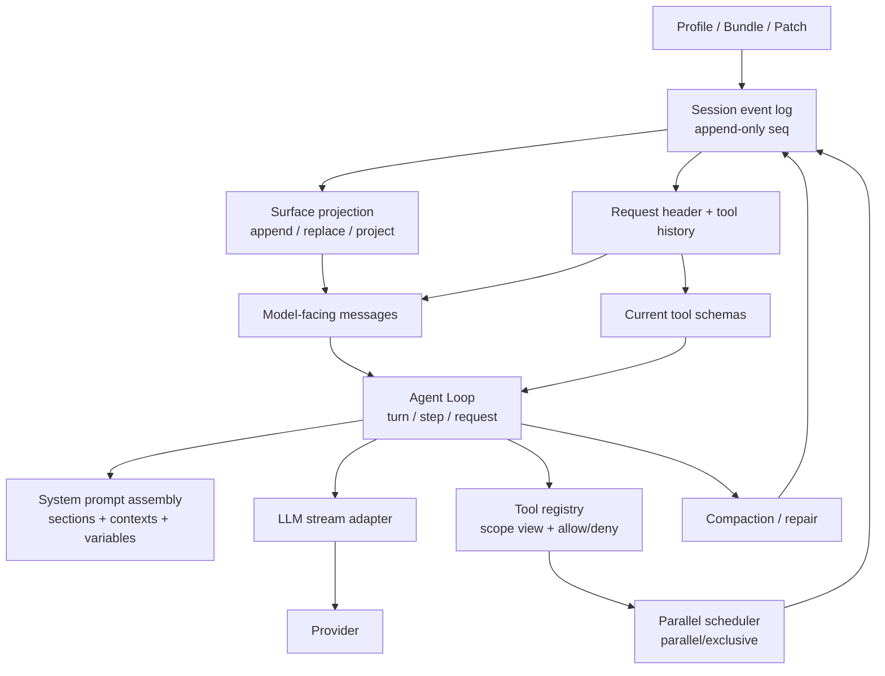

# DSH Runtime 初步核心架构图

- 依据：rc.5 精确源码静态审计（六份 phase2 报告）
- 证据等级：`S` 源码结构；运行行为和实际 Profile 组合仍为 `U`
- 用途：为阶段三对照实验和阶段四归因提供机制地图，不构成迁移或改造决定

## 1. 事件真源与请求构造



**核心事实：** 会话事件日志是请求的最终来源；模型看到的消息不是原始日志的直接拷贝，而是 surface/projection 的折叠结果。请求头保存模型路由、工具声明和适配器默认值。

## 2. Agent Loop

```text
idle
  -> wake / turn
  -> turn/start
  -> preStep
       -> claim inbox
       -> systemPrompt.assemble + runtime context
       -> agent/pre-step waterfall
  -> step/start
       -> prepareRequest / request-header
       -> llm.stream
       -> assistant message (text or tool-call)
       -> no tool-call: step completed
       -> tool-call: scheduler
            -> parallel dispatch pool or exclusive barrier
            -> ordered tool/result commits
       -> next step or turn/end
  -> idle
```

终止分支：

- 无工具调用的 assistant 响应：完成。
- max-tokens：turn 的终止原因被固定。
- 模型/工具失败：保守补写未回答的 tool result，关闭 step/turn，必要时由 resume repair 补 closers。
- 用户/父 Agent/dispose 取消：停止输入、abort、结算已开始内容，未启动调用补 synthetic result。

## 3. Prompt 与 Tool 边界

```text
SystemPrompt sections ──► rendered system text ──► system/message surface
SystemPrompt contexts ──► runtime-context snapshot ──► user/message surface
Tool registry ──► scoped visible definitions ──► ToolSchema[] ──► request header
LLM adapter ──► provider-specific system/tools wire fields
```

- Prompt sections 是长生命周期规则，contexts 是可刷新运行时事实，tools 是独立 schema 数组。
- Prompt assembly 每个 step 执行一次；同一 step 的重试只刷新 contexts，不重新装配 sections/tools。
- Tool schema 的模型可见字段只有名称、描述、参数和延迟加载标记；执行、超时、并发和 UI presentation 元数据不由模型直接看到。

## 4. Session / Replay / Compaction

```text
append event (seq = log.length)
  -> durable JSONL / in-memory test backend
  -> surface fold (append/replace/project)
  -> deriveMessages()
  -> request/header + toolHistory
  -> buildRequest

compaction:
  compaction/start
  -> summary
  -> user/message with replace intent
  -> compaction/end
```

- 原始事件不会因 compaction 删除；replace 改变模型可见 surface，日志保留被遮蔽事件。
- JSONL 恢复保证物理连续前缀；语义连续性由 agent-loop repair 补 `tool/result`、`step/end`、`turn/end`。
- fork 的 seed 边界取决于调用者；普通 Session fork 与 subagent fork 不是同一机制。

## 5. Parallel Scheduler

```text
assistant tool-call blocks (model order)
  -> classify each visible tool: parallel or exclusive
  -> first call chooses group mode
       parallel: rolling pool, re-check later calls before start
       exclusive: single-call barrier
  -> tool/call append in model order
  -> dispatch bodies may overlap
  -> tool/result commits only in contiguous model order
  -> additionalContexts enter next-step inbox in commit order
```

- 默认上限：10 个在途中 dispatch。
- prepare 与有序前置 policy 串行；只有 dispatch/body 重叠。
- abort 和 scheduler failure 都按“停止新启动、drain 已启动、补写未启动/未提交结果”的顺序收敛。

## 6. Subagent Lifecycle

```text
parent tool call: subagent / subagent_fork
  -> SubagentRuntime.startActivation
  -> provider capability checks
  -> manager
       -> spawn: fresh child
       -> fork: completed-turn prefix seed
  -> agents.create / resume
  -> child composition: preset, model, tools, policy, depth
  -> child runs its own Agent Loop
  -> settlement notice -> parent inbox
  -> dispose / flush / release ownership
```

关键边界：

- spawn 不继承父对话；fork 继承最后一个 `turn/end` 之前的已完成轮。
- 子工具来自 preset composition；spawn 可独立选 preset，fork 不能。
- 子模型默认继承父请求头；可覆写，但受 provider capability 和 route preflight 约束。
- 子权限是受限子集，approval 固定 `never`；子 Agent 不能自行扩大权限。
- `maxDepth` 默认 1，并持久化在每个子会话的委托上下文中。

## 7. 目前不能从架构图推出的结论

- 不能推出 DSH 的 loop 比 Pi 快；没有同模型、同任务、同工具的实测。
- 不能推出配置层或插件层的改动一定有效；需要阶段三的差异证据。
- 不能把 `native`/`ptc`、spawn/fork、parallel/exclusive 的静态存在当作 OmniDesk 当前实际使用方式。
- 不能把源码结构复杂度直接等同于运行时成本；必须分别测量请求、Token、缓存、时延、失败和完成率。
