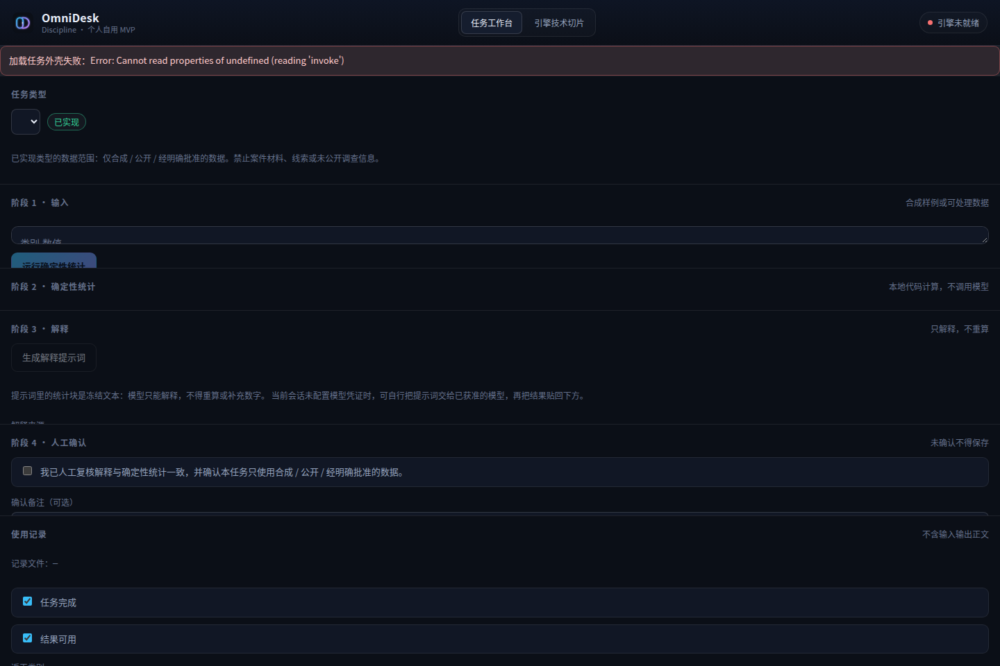

# OmniDesk 个人自用 MVP 最小纵向切片 —— 验证报告

> 日期：2026-10-16
> 范围：OmniDesk Discipline 个人自用 MVP（单用户、个人使用、**不分发**）
> 基线：[Git HEAD `17efd20` + 未提交改动]；唯一 tag `discipline-v0.2`；本轮**未提交、未推送、未打标签**。
> 证据等级口径：`static`（源码/文件事实）、`script`（脚本或运行测试）、`model`（真实模型输出）、`unverified`（未取得证据）。

---

## 1. 本阶段做了什么

把已有桌面技术切片推进为**作者本人可实际操作的最小工作流**。依据在执行前写下的：

- [docs/OmniDesk-Authorization-and-DataFlow-Gap-Audit.md](../../docs/OmniDesk-Authorization-and-DataFlow-Gap-Audit.md) —— 授权范围与数据流差距审计；
- [docs/OmniDesk-Task-Shell.md](../../docs/OmniDesk-Task-Shell.md) —— 共用任务外壳设计。

**做**：共用一个任务外壳（`omnidesk-task-shell/1`）+ 单一纵向试点「脱敏数据分析与生态研判」（`desensitized_analysis`）。
**不做**：通用 Agent 平台、工作流编辑器、Registry、复杂插件体系、GUI 之外的桌面功能扩展。

---

## 2. 授权边界（本节为审计结论，非实现声明）

证据来源：**用户提供的答复摘要**（仓库未保存原件；**未查看原始授权文件**）。原文：

> 在不出现身份证、电话号码、真实姓名、真实工作岗位及真实工作细节的前提下，经脱敏管理后，**仅用于数据分析和生态研判**的个人分析与使用可以，但**不得分发**。

| 项 | 状态 | 依据 |
| --- | --- | --- |
| 个人分析、数据分析与生态研判（数据经脱敏、无身份证/电话/真实姓名/岗位/工作细节） | 用户转述为**允许** | 用户答复摘要 |
| 分发材料、输入、输出或打包物 | **明确禁止** | 同上 |
| 周报、材料撰写、监督项目管理等真实工作用途 | **待确认**（不得由本答复推导为已获准） | 无 |
| 云模型 / 模型服务商、MCP / 外部工具、个人设备存储、运行环境 | **待确认**（逐项） | 无 |

未获相应授权前，只使用**合成、公开或经明确批准**的数据。**脱敏不等于获准**。

---

## 3. 实现范围与文件

| 文件 | 性质 | 说明 |
| --- | --- | --- |
| `desktop/src-tauri/src/task_shell.rs` | 新增（约 1468 行） | 任务类型目录、合成样例、确定性统计 + 指纹、冻结统计块、解释提示词、路径校验、产物落盘、使用记录读写 |
| `desktop/src-tauri/src/sha256.rs` | 新增 | 纯 Rust SHA-256（零第三方依赖） |
| `desktop/src-tauri/src/lib.rs` | 修改 | 注册 11 个 `task_*` Tauri 命令 |
| `desktop/src/workbench.tsx` | 新增（706 行） | 五段式工作台 UI |
| `desktop/src/{api,types}.ts`、`App.tsx`、`styles.css` | 修改 | 前端接口、类型、视图切换、样式 |
| `desktop/src-tauri/tests/task_shell_e2e.rs` | 新增 | 纵向流程端到端测试（2 例） |
| `templates/analysis/explanation-rules.md` | 新增 | 解释阶段规则（只解释、不重算） |
| `samples/analysis/synthetic-ecology-*.csv` | 新增 | 3 份**纯合成**样例 |
| `docs/OmniDesk-Product-and-Architecture-Roadmap.md` | 修改 | 新增「阶段 2.6：个人自用 MVP」 |
| `docs/OmniDesk-Next-Phase-Brief.md` | 修改 | 新增 §3.6 与优先级行 |

---

## 4. 共用任务外壳

版本 `omnidesk-task-shell/1`；六个共用字段：`task_type` / `input` / `stages` / `result` / `confirmation` / `persist`。

| 任务类型 | 状态 | 数据范围 |
| --- | --- | --- |
| `desensitized_analysis`（脱敏数据分析与生态研判） | **implemented** | 仅合成 / 公开 / 经明确批准的数据 |
| `weekly_report` | reserved | 未获准入，**不可执行** |
| `material_writing` | reserved | 未获准入，**不可执行** |
| `project_management` | reserved | 未获准入，**不可执行** |

`reserved` 类型在代码中被显式拒绝执行（见 §6 测试）。**保留边界 ≠ 已实现**。

---

## 5. 五段数据流（UI 实测路径）

1. **输入**：选任务类型 → 载入内置**合成样例**或粘贴输入；输入先过红线扫描（启发式）。
2. **确定性统计**：分组计数 / 总和 / 均值 / 最小 / 最大 + 稳定指纹，**全部由本地 Rust 计算，不经过引擎**。
3. **解释**：生成含**冻结统计块**与指纹的提示词；解释来源三选一（`user` / `model` / `model_unverified`）。
4. **人工确认**：必须勾选确认，未确认不得保存。
5. **保存**：落到**仓库外**的本地数据目录，文件名含时间戳与前 12 位指纹，`create_new` 拒绝覆盖。

**数值纪律**：统计值由确定性代码计算；提示词明确要求模型只解释、不得重算或补充数字；冻结块与指纹用于事后核对。

---

## 6. 实际运行的验证

### 6.1 Rust 测试（`script`）

```
cargo test --offline  →  49 passed; 0 failed
  unittests src/lib.rs            34 passed
  tests/host_integration.rs       13 passed
  tests/task_shell_e2e.rs          2 passed
  doc-tests                        0
```

`tests/task_shell_e2e.rs` 在**单个测试内串行**走完五段流程，并断言：

- 同一输入两次分析结果**逐字节一致**（统计可复现）；
- 产物写入**仓库外**目录，仓库内写入被**硬拒绝**；
- 已存在文件不被覆盖；
- 使用记录 JSONL **不含**输入或输出正文；
- `reserved` 任务类型**不可执行**。

### 6.2 前端构建（`script`）

```
cd desktop && npm run build  →  tsc --noEmit && vite build 通过
  dist/assets/index-ns_Oj9ly.css   7.48 kB
  dist/assets/index-DDPlaxF5.js  245.72 kB
```

### 6.3 界面渲染（`script`，仅限**前端**）



在 vite 开发服务器下截取的**前端**渲染：可见「任务工作台 / 引擎技术切片」视图切换、五个阶段标题、
数据范围提示、使用记录表单。**顶栏红色提示 `加载任务外壳失败: … reading 'invoke'` 属预期** —— 这是浏览器直连 vite，
没有 Tauri `invoke` 桥；该报错同时说明前端在宿主不可用时**不伪装成功**。

> ⚠️ 该图**不是**真实 Tauri 窗口的截图。见 §7 限制。

### 6.4 数据边界（`static` + `script`）

| 控制 | 强度 | 证据 |
| --- | --- | --- |
| 落盘路径校验（拒绝原版 DSH / agent / Codex 路径、DSH 源码树、仓库路径） | 代码强制 | `script`（测试断言仓库内写入被拒） |
| 拒绝覆盖已有产物 | 代码强制 | `script` |
| 使用记录不含输入输出正文 | 代码强制（字段表中无正文字段） | `script` |
| 输入红线关键词 + 证件 / 电话号数字扫描 | **启发式提示，非合规控制** | `static` |

**红线扫描不构成合规保障**，不能替代单位书面授权。

---

## 7. 未验证与限制

| 项 | 等级 | 说明 |
| --- | --- | --- |
| 模型只解释、不重算 | `unverified` | 本轮进程环境**无任何 API 密钥**，未读取隔离根凭证。只验证了提示词内确实含冻结块与指纹，**未取得真实模型输出**。 |
| 真实 Tauri 窗口视觉验收 | `unverified` | 窗口在 Xvfb 无 GPU 环境下渲染为空白（子 WebView 恒为 1×1，纯色计数 = 1）。**沿袭阶段 2 已记录的限制**，非本轮引入，也未定位原因。 |
| 输出侧引用真实性 | `unverified` | 需真实模型输出才能判定。 |
| 跨平台（Windows / macOS） | `unverified` | 仅 Linux 实测。 |
| 周报 / 通用材料撰写 / 完整项目管理 | 未实现 | 其真实材料准入状态**不能由本次实现推断**。 |

**窗口空白复现方式**（供后续定位）：Xvfb `-screen 0 1400x900x24` + `OMNIDESK_*` 指向一次性 `/tmp` 根；
`xwininfo` 可见 `OmniDesk Discipline 1280x820+60+40` 顶层窗口与类名 `omnidesk-desktop`（窗口身份正常），
但子 WebView 恒为 1×1；设置 `WEBKIT_DISABLE_COMPOSITING_MODE=1` / `WEBKIT_DISABLE_DMABUF_RENDERER=1` / `LIBGL_ALWAYS_SOFTWARE=1` 后仍为纯色。

---

## 8. 未接触的资源（边界确认）

- **未**修改 `runtime/deepseek-harness`；**未**触碰 `~/.dsh`、`~/.agents` 或原版 DSH 数据根。
- **未**读取、打印或复制任何凭证（含 `~/OmniDesk/runtime/dsh-home/.credentials.yaml`）。
- **未**改动模型路由、凭证或用户数据。
- **未**接触 `~/OmniDesk/quarantine/`（疑似真实红线数据）与 `knowledge/regulations/` 下 234 份正式制度文件。
- 截图与测试数据全部在 `/tmp` 的一次性根下完成，截断后清理。

---

## 9. 阶段出口判定

| 出口条件 | 结果 |
| --- | --- |
| 作者本人可完成一个合成数据纵向任务并在仓库外保存结果 | ✅ 实现完成；测试级已验证（UI 窗口视觉验收 `unverified`） |
| 统计计算可复现 | ✅ `script` |
| 失败与取消不会伪装成成功 | ✅ `script`（未确认不得保存；宿主不可用时前端显示错误） |
| 输入、结果、使用日志不进入 Git | ✅ `static`（`.gitignore` + 落盘在仓库外） |
| 不接触 DSH Runtime、原版 DSH 数据根或凭证 | ✅ `static` |
| 共用任务外壳与单一试点已分清 | ✅ 见 §4 |
| 未实现的其他工作流与未确认授权项明确列出 | ✅ 见 §4、§2、§7 |
| 保留原有未提交改动、不提交 / 不推送 / 不打标签 | ✅ 见 §10 |

---

## 10. 未提交状态

本轮结束时：

- 分支 `main`，HEAD `17efd20`，唯一 tag `discipline-v0.2`；
- 所有改动**未提交、未暂存、未推送**；
- 既有的 11 项 modified 与 30 项 untracked（含本阶段新增）**全部保留**。

---

## 11. 需要用户决定的准入事项

1. **授权原件**：仓库未保存授权文件。是否提供可留档的授权依据，以便逐项登记状态？
2. **模型 / 服务商授权**：若要真实模型跑解释阶段（把 `unverified` 变成 `model`），需要逐项授权与该端点凭证。
3. **数据范围确认**：`desensitized_analysis` 试点是否就是当前唯一获准用途？
4. **下一步**：先用合成数据继续打磨，还是先落实授权后接真实数据？
