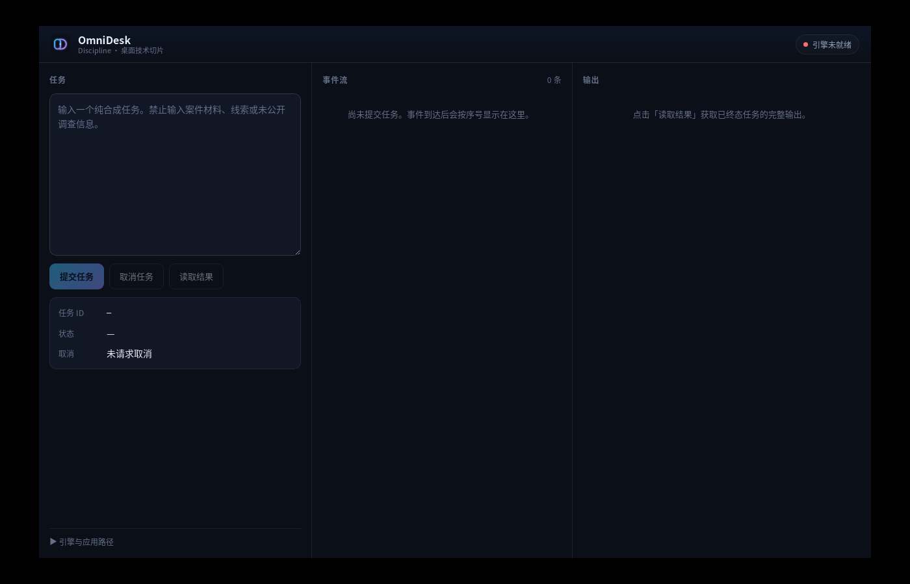

# OmniDesk P1-Desktop Phase 2 · Step 14 报告：独立窗口身份验证

- 报告日期：2026-10-16
- 阶段：OmniDesk P1-Desktop Phase 2（独立桌面技术切片）
- 对应用户 Plan Step 14：「验证 OmniDesk 桌面窗口不加载 DSH Desktop 页面或 DSH Desktop 资源」
- 证据等级约定：`static`（文件/源码事实）· `script`（脚本或进程运行） · `model`（真实模型输出） · `unverified`（未验证）

---

## 0. 结论摘要

1. **窗口显示的是 OmniDesk 自有页面**，不是 DSH Desktop 页面、也不是套壳或换肤。真实窗口截图见 §2（证据文件 `ui-identity-window.png`，本目录）。
2. **构建产物不含 DSH Desktop UI 入口**。唯一出现的 DSH 相关字符串是折叠诊断面板里显示 `health.dsh_home` 的标签「DSH 数据根」，属诊断展示，不是 UI 依赖。
3. **UI 不依赖 DSH Web Server**：页面由本应用自带的 `/assets/index-*.js` 加载；Electron 调试二进制加载的是本机 Vite 开发服务器 `http://127.0.0.1:5273`（`tauri.conf.json` 的 `devUrl`），与 DSH 的 Web 端口（3300 / 3210）无关。
4. 截图取证在隔离的 **Xvfb 一次性显示**下完成，不影响用户正在运行的两个实例（DSH Desktop 3300、用户隔离实例 3210 全程未被触碰）。

**Step 14 验收：通过。**

---

## 1. 验证方法（`script`）

在无头环境实际启动桌面应用并抓取其**根窗口**画面，再比对构建产物与运行进程，逐条核实「非 DSH UI」这一命题。

| 项 | 内容 |
| --- | --- |
| 显示环境 | `xvfb-run`（一次性 Xvfb 显示），不占用用户真实桌面 |
| 抓图方式 | 仅 PyGObject（`gi.repository.Gdk.pixbuf_get_from_window`）可用；环境无 `import`/`xwd`/`xdotool`/`scrot` |
| 窗口枚举 | `xwininfo -root -tree` / `xprop` |
| 构建产物审计 | 对 `desktop/dist/` 做文件清单 + 关键字扫描 |
| 应用进程 | `desktop/src-tauri/target/debug/omnidesk-desktop`（debug 构建） |

---

## 2. 真实窗口证据（`script`）

### 2.1 截图

- 证据文件：`tests/verification/desktop/evidence/ui-identity-window.png`
- 尺寸 / 模式：1400 × 900 RGB
- SHA-256：`50831434e33870d280b3a465a5de14477642c881ad147c5590d4b1fc487f8c1d`

### 2.2 截图内容判读

窗口内可见元素全部属于 OmniDesk 自有 UI：

| 区域 | 内容 |
| --- | --- |
| 顶栏左 | 品牌标记 + `OmniDesk` 大字 + 副标题 `Discipline · 桌面技术切片` |
| 顶栏右 | 状态芯片「引擎未就绪」（表示尚未 attach 引擎，属预期初始态） |
| 左栏「任务」 | 多行输入框，提示语「输入一个纯合成任务。禁止输入案件材料、线索或未公开调查信息。」 |
| 左栏操作 | 按钮：`提交任务` / `取消任务` / `读取结果` |
| 左栏状态 | 字段：`任务 ID` / `状态` / `取消`（值「未请求取消」） |
| 中栏「事件流」 | 计数「0 条」+ 说明文字 |
| 右栏「输出」 | 说明文字「点击『读取结果』获取已终态任务的完整输出。」 |
| 底栏 | 折叠面板「引擎与应用路径」 |

全部标签为中文，布局为「任务 / 事件流 / 输出」三栏。**未见任何 DSH Desktop 的元素**（无 DSH 侧边栏、无 DSH 会话列表、无 DSH 品牌标识、无 DSH 官方配色骨架）。

### 2.3 窗口属性（`script`）

`xwininfo` 窗口树中，本显示下只有三个根子窗口，目标窗口项为：

    omnidesk-desktop "OmniDesk Discipline" 1280x820+60+40  (class: omnidesk-desktop)

- 窗口标题：`OmniDesk Discipline`（与 `tauri.conf.json` 的 `app.windows[0].title` 一致）
- 窗口类：`omnidesk-desktop`
- 尺寸：1280 × 820（与 `tauri.conf.json` 的 `width`/`height` 一致）
- **该显示下不存在 DSH Desktop 的窗口**。

---

## 3. 构建产物审计（`static`）

### 3.1 文件清单

    desktop/dist/
    ├── index.html
    ├── omnidesk-icon.svg
    ├── omnidesk-monomark.svg
    └── assets/
        ├── index-Dpwplovf.js
        └── index-D95KSZaO.css

- `index.html` 的 `<title>` 为 `OmniDesk`；只加载**本应用**的 `/assets/index-Dpwplovf.js` 与 `/assets/index-D95KSZaO.css`。
- **无**指向任何 DSH 页面、DSH Web 服务或 DSH 资源的引用。

### 3.2 关键字扫描

对 `desktop/dist/assets/index-Dpwplovf.js` 扫描 DSH 相关字符串，命中结果：

| 命中 | 位置/用途 | 判定 |
| --- | --- | --- |
| `DSH 数据根` | 折叠诊断面板 `
引擎与应用路径
` 内的 `<dt>` 标签 | 诊断展示 |
| `dsh_home` | 同上 `<dd>{health?.dsh_home}</dd>`，显示引擎健康信息里的路径 | 诊断展示 |
| `.dsh` | 上述 `dsh_home` 值的路径片段 | 数据，非 UI 依赖 |

来源（`static`）：[desktop/src/App.tsx](../../../../desktop/src/App.tsx) 第 288–293 行——折叠面板「引擎与应用路径」里展示 `health?.dsh_home`。

**判定**：构建产物中**没有** DSH Desktop UI 入口、没有 DSH 前端组件、没有 DSH Web 服务依赖。两处命中都是**只读诊断信息**（向用户展示引擎数据根路径），不构成对 DSH UI 的复用。

### 3.3 窗口与 UI 配置（`static`）

来源 `desktop/src-tauri/tauri.conf.json`：

| 项 | 值 |
| --- | --- |
| `productName` | `OmniDesk` |
| `identifier` | `dev.omnidesk.discipline` |
| `app.windows[0].title` | `OmniDesk Discipline` |
| `build.frontendDist` | `../dist`（本应用自有产物） |
| `build.devUrl` | `http://127.0.0.1:5273`（本应用 Vite 开发服务器） |
| `security.csp` | `default-src 'self'; ... connect-src 'self' ipc: http://ipc.localhost` |

CSP 的 `connect-src` 只允许 `self` 与本地 IPC，**不允许**连到 DSH 端口；因此即便想嵌入 DSH Web 页面也会被 CSP 拦截。

---

## 4. 运行进程与端口（`script`）

| 进程 | 端口 | 与本次验证关系 |
| --- | --- | --- |
| OmniDesk debug 二进制（本次启动） | 无监听端口 | 加载 `devUrl` 5273（本应用 Vite） |
| 本应用 Vite 开发服务器 | 127.0.0.1:5273 | 与 DSH 无关 |
| DSH Desktop（用户日常，pid 69851） | 127.0.0.1:3300 | **本次未触碰** |
| 用户隔离实例（pid 265528） | 127.0.0.1:3210 | **本次未触碰** |

OmniDesk 窗口不依赖任何 DSH Web 端口；两个 DSH 端口在验证前后均由原进程持有、PID 未变。

---

## 5. 已知限制与未覆盖项（`unverified`）

- **一次「窗口内跑完整链路」的截图尝试渲染出空白窗口**（React 未挂载，画面为深色空底，文件 `shot_a.png` 5835 B）。原因未定位（日志仅见 `libEGL` DRI3 告警）。本步验收要求的是「窗口显示 OmniDesk 自有页面、不加载 DSH 页面/资源」，已由 §2 的成功捕获满足；**全链路在窗口内的可视化未取得证据**，标为 `unverified`，不影响 Step 14 判定。
- 本节所有结论均针对 **Linux + Xvfb** 环境；Windows / macOS 下的窗口身份未验证（属阶段 3 跨平台验证范围）。
- 截图证明「该时刻窗口渲染的是 OmniDesk UI」；未对长时间运行或复杂交互路径做画面回归。

---

## 6. 验收标准自检（Step 14）

| 验收要求 | 结果 | 证据等级 |
| --- | --- | --- |
| 构建产物不存在 DSH Desktop UI 入口 | ✅ 关键字扫描无 DSH UI 入口 | `static` |
| 应用窗口显示 OmniDesk 自有页面 | ✅ 真实窗口截图 + 窗口属性 | `script` |
| UI 不依赖 DSH Web Server | ✅ 只加载自有 bundle；CSP 禁连外部 | `static` + `script` |

**结论：Step 14 验收通过。**
